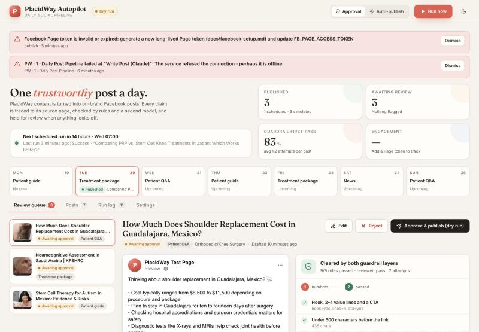
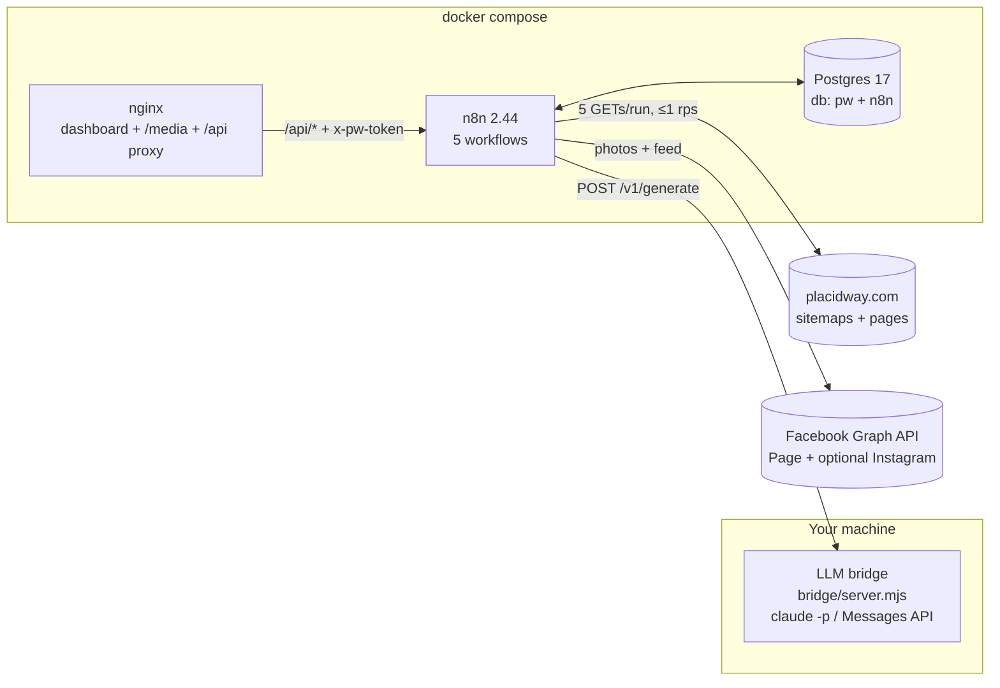

# PlacidWay Social Autopilot

**An n8n workflow that turns public PlacidWay content into one guardrailed, on-brand Facebook post per day.** It includes a human review dashboard, branded images, scheduling, alerting and engagement read-back.

```
Sitemaps ─▶ pick 1 fresh URL ─▶ extract (JSON-LD) ─▶ Claude writes ─▶ rules + Claude reviewer ─▶ brand image ─▶ approve / auto ─▶ Facebook
   ▲             │ never twice (UNIQUE)                     ▲  retry with feedback ◀─┘                                      │
 07:00 daily     └─ weekday rotation + category cool-down   └──────────── escalate to a human after N attempts            run log + alerts
```



| Deliverable | Where |
|---|---|
| Workflow source (exported n8n JSON) | [`workflows/`](workflows/): five importable workflows |
| README: setup, env, running, architecture | this file |
| Sample output: posts from real PlacidWay pages | [`samples/`](samples/README.md) |
| Facebook token guide | [`docs/facebook-setup.md`](docs/facebook-setup.md) |
| Recording run-sheet | [`docs/recording-script.md`](docs/recording-script.md) |

---

## Quick start

Prerequisites: Docker Desktop, Node 20.6+, and either the [Claude CLI](https://docs.claude.com/en/docs/claude-code) logged in or an `ANTHROPIC_API_KEY`.

```bash
npm run setup      # creates .env with fresh secrets, starts postgres + n8n + dashboard, imports & activates workflows
npm run bridge     # in a second terminal: the LLM bridge (uses your Claude CLI login)
```

- **Dashboard:** http://localhost:8080. Click **Run now** and a draft lands in the review queue in about 1–2 minutes.
- **n8n editor:** http://localhost:5678. On first visit, create the local owner account.

Everything starts in **approval mode + dry run**, so nothing touches Facebook until you set a Page token and turn dry run off. See [docs/facebook-setup.md](docs/facebook-setup.md).

```bash
npm test           # 21 unit tests over the real Code-node sources (fixtures are real PlacidWay pages)
npm run build      # regenerate workflows/*.json from workflows/src after editing code
tools/reimport.sh  # rebuild + re-import + re-activate in the running n8n
npm run samples    # export generated posts to samples/README.md
npm run reset-data # wipe posts/runs/alerts for a clean demo (keeps settings)
```

---

## Architecture



| Workflow | Purpose | Triggers |
|---|---|---|
| **PW · 1 · Daily Post Pipeline** | select → extract → generate → guardrails → image → save → (auto) publish | Schedule 07:00, Manual, dashboard **Run now** |
| **PW · 2 · Publish Post** | Publishes one approved post: dry-run simulation or Graph API (photo upload → feed post, immediate or natively scheduled), optional Instagram cross-post, FB error classification | Called by the pipeline (auto mode) and the dashboard (approve / retry) |
| **PW · 3 · Dashboard API** | `GET /api/state`, `POST /api/action` (approve, retry, reject, settings, run, ack, engagement) | Webhooks behind nginx |
| **PW · 4 · Engagement Read-back** | Settles scheduled posts whose time passed; stores reactions / comments / shares / clicks snapshots | Every 6 h, manual, dashboard |
| **PW · 5 · Error Handler** | Error workflow for all of the above: alert row, closes run as `error`, releases half-drafted URL, optional Slack/Discord webhook | n8n Error Trigger |

### Data model (`db/init/01-schema.sql`)

- **`posts`:** one row per source URL. `UNIQUE(source_url)` is the hard "never post the same URL twice" guarantee. A row also holds the source excerpt the model was allowed to see, the generated parts, claim→quote grounding, the full guardrail report, attempts, status, FB ids and the reviewer.
- **`runs`:** one row per pipeline or publish execution (item chosen, status, FB post id, error, details including the simulated Graph request in dry run).
- **`alerts`:** shown as a banner on the dashboard, plus an optional chat webhook.
- **`engagement`:** time-series snapshots per post. `post_latest_engagement` is a view over it.
- **`settings`:** runtime config the dashboard edits. Secrets stay in `.env`.

Post lifecycle:
`drafting → pending_approval | needs_review → approved → published | scheduled | publish_failed`, or `rejected`.
A pipeline crash sets `failed`, which releases the URL so it can be retried.

---

## How each requirement is met

### 1. Trigger
A Schedule Trigger fires daily at 07:00 in `TZ`. There is also a Manual Trigger for testing in the editor, plus an Execute Workflow Trigger so the dashboard's **Run now** (and "Run: Patient Q&A" etc.) can start it. `Start Run` normalises all three into one run context.

### 2. Extract: sitemaps + JSON-LD
**Method:** XML sitemaps for discovery, then one HTML fetch per run, parsed from **JSON-LD first**. No headless browser.

- **Why sitemaps:** robots.txt advertises them and they're built for crawlers. Each one lists a content type sorted by `lastmod` (5.1k articles, 3.8k packages, 4.5k Q&As, 700 news items) and often includes the featured image. One request per type replaces crawling paginated listing pages.
- **Why JSON-LD:** every PlacidWay page embeds `Article.articleBody`, `Product` (+ `offers` price), `BlogPosting`, `FAQPage` and `BreadcrumbList` (category). That is the publisher's own structured statement of the page, so it is far more stable than CSS selectors. Open Graph (`og:title/description/image`) is the second fallback and stripped main-content HTML the third. If all three come back thin, the run fails loudly with "markup may have changed" instead of generating from nothing.
- **Politeness:** 4 sitemap GETs batched at 1 per 1.1 s, a 1.2 s wait, then 1 page GET: **5 requests a day**. There is a descriptive `User-Agent`, retries with back-off, and only `Allow`ed paths (images come from `/cdn-cgi/image/`, which robots.txt explicitly allows).
- **Captured fields:** title, URL, summary, body (capped at 6,000 chars), featured image, category, published date, listed price, top FAQs.

### 3. Select: one item, never twice
`Pick Candidate` takes the freshest 60 per type, drops every URL already in `posts`, and scores the rest:

- the **weekday rotation** (Mon guide · Tue package · Wed Q&A · Thu guide · Fri package · Sat news · Sun Q&A, editable in Settings)
- a **category cool-down** (no repeat of the last 3 posts' treatment categories)
- freshness, and a small preference for items that have images

If today's type has nothing fresh, it falls back to another type, avoiding yesterday's. The reason is saved, e.g. *"Rotation picks "package" for Tue; category "Neurology" not used in last 3 posts"*.

`Claim URL` then inserts the row **before** any expensive work. On a conflict it only takes over a row whose earlier run `failed`; otherwise it returns nothing and the run is logged as skipped. The database enforces uniqueness even if two runs race.

### 4. Generate
Claude (Sonnet by default) gets a brand-voice system prompt, the source excerpt and a **JSON schema**: `hook`, 2–4 `lines`, `cta`, 3–5 `hashtags`, and `claims[]`, a verbatim source quote for every value line. Code then **assembles** the post, so the structure is deterministic rather than hoped for:

```
{hook}

• {line}
• {line}

{cta}
👉 {source URL + UTM}

#Tag #Tag #Tag
```

### 5. Guardrails: two independent layers, fail closed
**Layer 1: deterministic rules** (`workflows/src/lib/guardrails.js`, unit-tested). These are fast, free and explainable:

| Rule | What it catches |
|---|---|
| Structure | hook + 2–4 lines + CTA |
| Length | < 500 chars before the link |
| Hashtags | 3–5, well-formed, de-duplicated |
| Link | points at the exact source page |
| Medical claims | cure, guaranteed, 100%, risk-free, no side effects, painless, permanent results, miracle, proven, reverses, eliminates, FDA-approved, instant results… Negation-aware, so "isn't proven" passes |
| Superlatives | best / #1 / world-class / cheapest unless the source says it |
| Numbers | **every number in the post must appear in the source** (82%, 2025, 10–14 days…) |
| Prices | currency amounts must match the source verbatim. No invented prices |
| Grounding | every line's quote must actually be found in the source (shingle match), which catches fabricated citations |

**Layer 2: an independent LLM reviewer** (Claude Haiku, different prompt, never sees the writer's instructions). It audits the post against the source for `medical_claim`, `unsupported_fact` and `invented_price` (high), misleading or pressuring framing (medium), and tone (low, advisory).

**Decision** (`Guardrail Verdict`):
- **Both pass:** queue for approval, or publish in auto mode.
- **Either fails and attempts remain:** loop back to the writer with the exact findings ("Every number appears in the source: not in source: 70").
- **Still failing after `max_attempts` (3):** status `needs_review`, which **never auto-publishes**. A human edits or rejects it.
- **Reviewer unavailable:** fail closed to human review.

Why both: rules can't judge paraphrase or implication, and an LLM can be talked into things. Rules give a guaranteed floor and the reviewer handles nuance. In the sample runs, the number rule caught a draft that wrote "10 to 14 days" where the source says "ten to fourteen days". The rewrite matched the source. During development, the medical-claims rule flagged a cautionary "doesn't mean it's proven", which led to making it negation-aware (with a test).

**Human edits are held to the same rules.** The dashboard runs the identical rule engine in the browser while you type (Approve is disabled while any rule fails). The API re-checks on the server and returns `422` if someone bypasses the UI.

### 6. Publish
**PW · 2 · Publish Post** uploads the branded image to `/{page}/photos` with `published=false` (`temporary=true` when scheduling), then creates `/{page}/feed` with `attached_media`. That is Meta's documented pattern, and it means one code path handles immediate and natively scheduled posts, with or without an image. `post_time = "HH:MM"` schedules the next slot through Facebook's own scheduler (≥ 15 min ahead). Text-only posts send `link` for a link preview.

**Dry run** (default) performs every step except the network write and stores the exact Graph calls it would have made in the run log.

### 7. Review option
`settings.publish_mode = approval | auto`. You can flip it from the header toggle, the Settings tab, or SQL.

- **Approval:** clean drafts become `pending_approval` and wait in the dashboard queue. You get a Facebook-style preview, the guardrail report, the AI reviewer's notes, and the source excerpt with each claim's supporting quote highlighted (hover a claim to jump to it). From there you can **Edit**, **Reject (with note)** or **Approve & publish**.
- **Auto:** clean drafts publish immediately. Flagged drafts still stop for a human.

### 8. Logging, retries, alerts
- **Every execution** writes to `runs`: item chosen, post text (in `posts`), FB post id, status, error and details. The dashboard's **Run log** tab shows it with an expandable JSON view.
- **Retries:** PlacidWay fetches 3× / 5 s, LLM calls 2× / 8 s, Facebook calls 3× / 10 s, and the bridge queues requests with a concurrency limit.
- **Facebook errors are classified:** code 190 is an expired token ("generate a new long-lived Page token…"), 4/17/32/613 are rate limits, 10/200 are permissions, 5xx/timeouts are network. The post becomes `publish_failed` with a **Retry publish** button.
- **Never silent:** every workflow names **PW · 5 · Error Handler** as its error workflow. A crash anywhere (site down, markup change, bridge down) creates a dashboard alert with a hint, marks the run `error`, releases the half-drafted URL, and optionally posts to `ALERT_WEBHOOK_URL` (Slack- or Discord-compatible).

---

## Stretch goals

| Goal | Status |
|---|---|
| Variety rules | ✅ Weekday content-type rotation + treatment-category cool-down, both editable in the dashboard |
| Image handling | ✅ Full-bleed 1200×630 smart crop via PlacidWay's Cloudflare image endpoint, plus a PlacidWay brand bar (n8n Edit Image / GraphicsMagick). When there's no image, a branded title card is **rendered**. If the image download fails, it falls back to the card |
| Cross-posting | ✅ Instagram (behind `crosspost_instagram` + `IG_USER_ID`): re-uses the FB-hosted photo URL → `/media` → `/media_publish`. It's best effort: an IG failure raises a warning but never fails the FB post |
| Dashboard | ✅ `http://localhost:8080`: review queue, posts gallery with engagement, week view, run log, settings, alerts, dark mode |
| Engagement read-back | ✅ Every 6 h: reactions, comments, shares, `post_clicks` snapshots stored next to each post (live posts only; dry-run posts have nothing real to read) |

---

## Configuration

### `.env`

`npm run setup` creates this file from `.env.example` with random secrets.

| Variable | Default | Purpose |
|---|---|---|
| `TZ` | `Asia/Jakarta` | Schedule, weekday rotation, `post_time` |
| `POSTGRES_USER` / `POSTGRES_PASSWORD` | `pw` / `pw_local_dev` | Database |
| `N8N_ENCRYPTION_KEY` | random | Encrypts n8n credentials |
| `PW_API_TOKEN` | random | Shared secret nginx injects; n8n webhooks reject requests without it |
| `LLM_BRIDGE_URL` | `http://host.docker.internal:8787` | Where n8n reaches the bridge |
| `LLM_BRIDGE_TOKEN` | random | Bridge auth header |
| `LLM_BACKEND` | `cli` | `cli` = your `claude` login · `api` = Anthropic Messages API |
| `LLM_MODEL_WRITER` / `LLM_MODEL_REVIEWER` | `sonnet` / `haiku` | Model aliases |
| `ANTHROPIC_API_KEY` | (none) | Only for `LLM_BACKEND=api` |
| `FB_GRAPH_VERSION` | `v24.0` | Graph API version |
| `FB_PAGE_ID` / `FB_PAGE_ACCESS_TOKEN` | (none) | Your **test** Page. Not needed in dry run |
| `IG_USER_ID` | (none) | Instagram Business account linked to the Page |
| `ALERT_WEBHOOK_URL` | (none) | Optional Slack/Discord incoming webhook |
| `PW_BASE_URL` | `https://www.placidway.com` | Content source |
| `PW_USER_AGENT` | descriptive | Sent on every PlacidWay request |
| `PW_UTM` | `utm_source=facebook&…` | Appended to the post link |

### Runtime settings (dashboard → Settings, or the `settings` table)

`publish_mode`, `dry_run`, `post_time`, `brand_images`, `crosspost_instagram`, `max_attempts`, `avoid_recent_categories`, `rotation`.

---

## Project layout

```
workflows/
  1-daily-post-pipeline.json … 5-error-handler.json   ← import these into n8n
  src/code/**.js        Code-node sources (real files, unit-tested)
  src/lib/*.js          shared helpers inlined at build time (guardrails, categories)
tools/
  build-workflows.mjs   assembles the n8n JSON from src (+ copies guardrails to the dashboard)
  setup.sh / reimport.sh / q.sh / render-test.mjs
bridge/server.mjs       zero-dependency LLM bridge (Claude CLI or Anthropic API)
dashboard/              nginx-served SPA (vanilla JS) + nginx template
db/init/01-schema.sql   application schema + default settings
tests/                  node:test suites + real PlacidWay page fixtures
samples/                generated posts from real pages, with source URLs and images
docs/                   Facebook setup, recording run-sheet
```

**Why Code nodes live in files:** keeping n8n logic as plain `.js` files makes it diffable, reviewable and testable (`npm test` runs the exact code n8n runs against real PlacidWay HTML). The build step keeps the canvas readable: each Code node is one named step, and sticky notes explain each stage.

---

## Design decisions and trade-offs

- **The LLM bridge, not an in-container CLI.** You asked for the Claude CLI. Its login lives in the macOS Keychain, which the n8n container can't read. A ~150-line, zero-dependency host bridge (bound to localhost, token-protected) keeps credentials out of the image, adds a concurrency limit and timeouts, and returns `503` so n8n's retry treats failures as transient. Setting `LLM_BACKEND=api` swaps in the Messages API with no workflow change, which is the production path.
- **Structured output plus code assembly** rather than asking for a finished post. The format is guaranteed, and the quote-per-claim makes grounding checkable.
- **The URL is claimed before generation.** It costs a row on failure, but the database (not workflow logic) guarantees no duplicates. A crashed run releases the URL via the error handler.
- **Rules can't be overridden by a human; the LLM reviewer is advisory for humans.** The rules encode legal and brand red lines; the reviewer handles nuance a person can judge.
- **Retry on 4xx from Facebook** is wasteful: n8n's built-in retry can't filter by status. It costs about 20 s on a bad token and never double-posts, because a failed call created nothing. A timeout *after* Facebook accepted a post could in theory duplicate it. The production fix is an idempotency check (look up recent page posts by link) before retrying.
- **Postgres over n8n Data Tables / Google Sheets:** real constraints (`UNIQUE`), transactions, and one store the dashboard can query.
- **Images are re-hosted locally (`/media`)** so the reviewer sees exactly what will be uploaded. Facebook receives the bytes via multipart, so there's no public URL to expose.

### What I'd add for production
Hosted n8n with queue mode and a secrets manager; a Meta System User token (it never expires) instead of a long-lived user-derived Page token; an idempotency guard on publish; per-category prompt examples tuned with the marketing team; an eval set of past posts for regression-testing prompt changes; Slack approvals for reviewers who live in Slack; and LinkedIn via the same Publish sub-workflow pattern.
