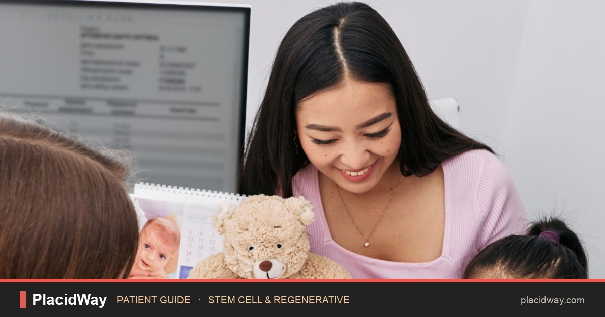
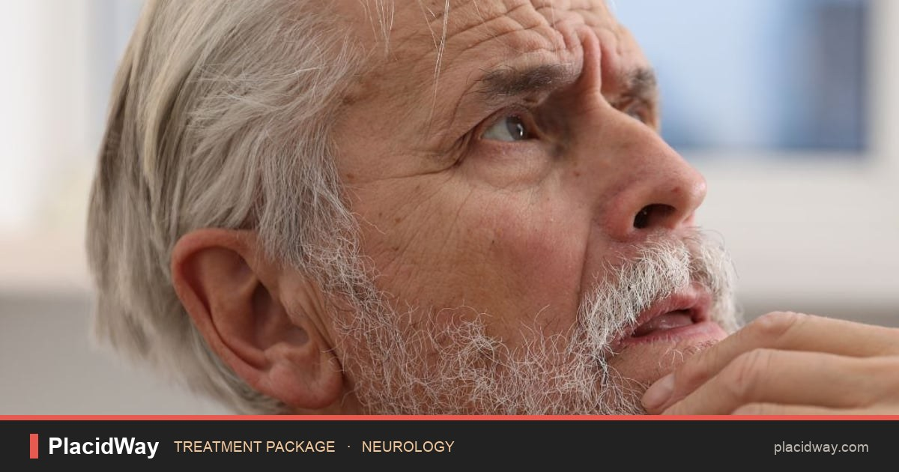
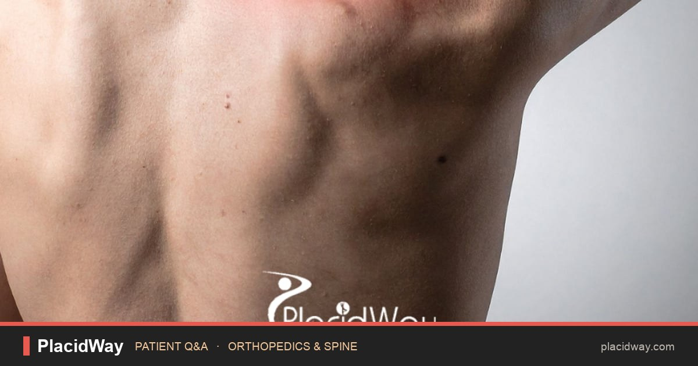
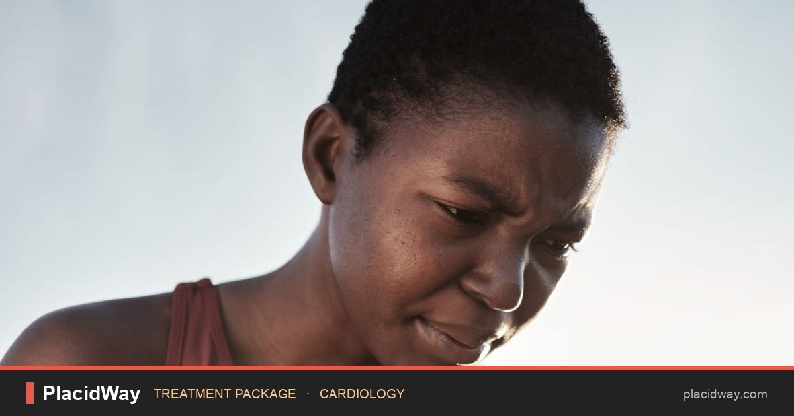
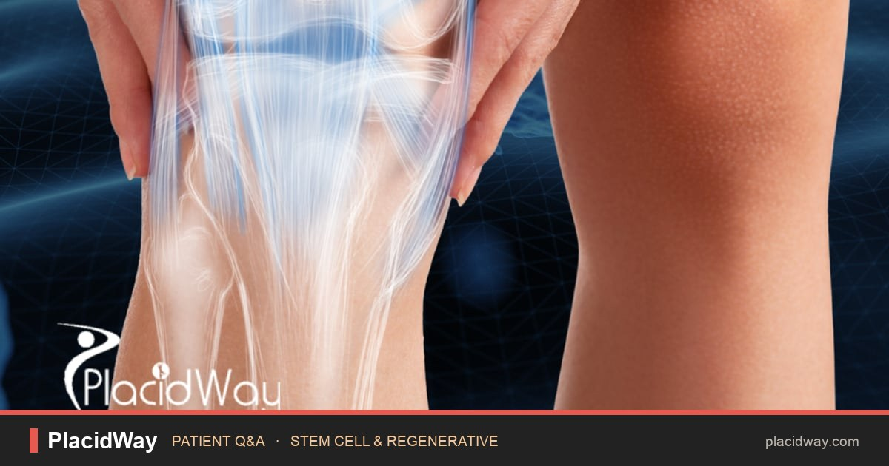

# Sample output: posts generated from real PlacidWay pages

Generated by the live pipeline on 2026-10-20 (Claude Sonnet writer, Claude Haiku reviewer).
Each entry shows the source page, the final post exactly as it would be published, the branded image, and the guardrail outcome.
Exported with `node tools/export-samples.mjs`.

| # | Type | Source | Attempts | Guardrails | Outcome |
|---|---|---|---|---|---|
| 1 | Patient guide (article) | [Stem Cell Therapy for Autism in Mexico: Evidence & Risks](https://www.placidway.com/article/9796/Why-Families-Are-Researching-Stem-Cell-Therapy-for-Autism-in-Mexico-What-Evidence-Should-They-Ask-For) | 1 | ✅ passed | **live on Facebook**: [view post](https://www.facebook.com/122096451345521209/posts/122096451291521209) |
| 2 | Treatment package | [Neurocognitive Assessment in Saudi Arabia / KFSHRC](https://www.placidway.com/package/8700/Neurocognitive-Assessment-Package-in-Riyadh-Saudi-Arabia-at-KFSHRC) | 1 | ✅ passed | pending approval |
| 3 | Patient Q&A | [How Much Does Shoulder Replacement Cost in Guadalajara, Mexico?](https://www.placidway.com/answer-detail/29/How-Much-Does-Shoulder-Replacement-Cost-in-Guadalajara-Mexico) | 2 | ✅ passed | pending approval |
| 4 | News | [PlacidWay Research Identifies Shift in Medical Tourism as GLP-1 Medications Influence Bariatric Surgery Demand and Post-Weight-Loss Procedures](https://www.placidway.com/news-detail/4624/PlacidWay-Research-Identifies-Shift-in-Medical-Tourism-as-GLP-1-Medications-Influence-Bariatric-Surgery-Demand-and-Post-Weight-Loss-Procedures) | 1 | ✅ passed | scheduled (dry run, simulated) |
| 5 | Patient guide (article) | [Stem Cell Anti Aging Cost in Europe 2026](https://www.placidway.com/article/5665/Stem-Cell-Anti-Aging-Cost-in-Europe-Explore-Clinics-Treatments-and-Patient-Packages) | 1 | ✅ passed | published (dry run, simulated) |
| 6 | Treatment package | [Cardiac Risk Assessment in Saudi Arabia / KFSHRC](https://www.placidway.com/package/8699/Cardiac-Risk-Assessment-Package-in-Riyadh-Saudi-Arabia-at-KFSHRC) | 2 | ✅ passed | pending approval |
| 7 | Patient Q&A | [Comparing PRP vs. Stem Cell Knee Treatments in Japan: Which Works Better?](https://www.placidway.com/answer-detail/571066/Comparing-PRP-vs-Stem-Cell-Knee-Treatments-in-Japan-Which-Works-Better) | 1 | ✅ passed | published (dry run, simulated) |

---

## 1. Stem Cell Therapy for Autism in Mexico: Evidence & Risks

- **Outcome:** **live on Facebook**: [view post](https://www.facebook.com/122096451345521209/posts/122096451291521209)
- **Source:** https://www.placidway.com/article/9796/Why-Families-Are-Researching-Stem-Cell-Therapy-for-Autism-in-Mexico-What-Evidence-Should-They-Ask-For
- **Type / category:** Patient guide (article) · Stem Cell Therapy
- **Why selected:** Dashboard requested "article"; category "Stem Cell & Regenerative" not used in last 3 posts
- **Guardrails:** 9/9 rules passed · AI reviewer: pass · 1 attempt(s)

```text
Considering stem cell therapy for autism in Mexico? Here's what families should ask first.

• These interventions remain investigational, with unproven benefits.
• The FDA says regenerative medicine products aren't approved to treat autism.
• PlacidWay lists regenerative programs in Tijuana, Monterrey and Mexico City.

Read PlacidWay's full guide to compare programs and know what to ask.
👉 https://www.placidway.com/article/9796/Why-Families-Are-Researching-Stem-Cell-Therapy-for-Autism-in-Mexico-What-Evidence-Should-They-Ask-For?utm_source=facebook&utm_medium=social&utm_campaign=pw_daily_autopilot

#StemCellTherapy #AutismAwareness #MexicoHealthcare #MedicalTourism #PlacidWay
```



<details><summary>Grounding: each line's supporting quote from the source</summary>

| Post line | Verbatim source quote |
|---|---|
| These interventions remain investigational, with unproven benefits. | “These interventions remain investigational, with unproven benefits.” |
| The FDA says regenerative medicine products aren't approved to treat autism. | “The US Food and Drug Administration states that regenerative medicine products have not been approved to treat autism” |
| PlacidWay lists regenerative programs in Tijuana, Monterrey and Mexico City. | “PlacidWay's current marketplace listings include autism-focused regenerative programs in destinations such as Tijuana, Monterrey and Mexico City” |

</details>

> **AI reviewer:** Post passes compliance review. All statements are directly supported by the SOURCE. The post accurately conveys that stem cell therapy for autism remains investigational and unproven, correctly attributes FDA guidance, identifies PlacidWay as a listing service rather than treatment provider, and maintains appropriate cautious tone throughout. No medical claims, unsupported facts, invented prices, or misleading framing detected.

---

## 2. Neurocognitive Assessment in Saudi Arabia | KFSHRC

- **Outcome:** pending approval
- **Source:** https://www.placidway.com/package/8700/Neurocognitive-Assessment-Package-in-Riyadh-Saudi-Arabia-at-KFSHRC
- **Type / category:** Treatment package · Executive Healthcheck
- **Why selected:** Rotation picks "package" for Tue; category "Neurology" not used in last 3 posts
- **Guardrails:** 9/9 rules passed · AI reviewer: pass · 1 attempt(s)

```text
Noticing memory changes and wondering what's behind them? 🧠

• Includes a specialist neurology or geriatric medicine consultation
• Covers brain MRI and bloodwork to explore reversible causes
• All-inclusive baseline package priced at USD 1,050
• You'll receive a written report and one follow-up consultation

See what's included and compare options on PlacidWay
👉 https://www.placidway.com/package/8700/Neurocognitive-Assessment-Package-in-Riyadh-Saudi-Arabia-at-KFSHRC?utm_source=facebook&utm_medium=social&utm_campaign=pw_daily_autopilot

#NeurocognitiveAssessment #Riyadh #SaudiArabia #CognitiveHealth #ExecutiveHealthCheck
```



<details><summary>Grounding: each line's supporting quote from the source</summary>

| Post line | Verbatim source quote |
|---|---|
| Includes a specialist neurology or geriatric medicine consultation | “Specialist neurology, behavioral neurology, or geriatric medicine consultation.” |
| Covers brain MRI and bloodwork to explore reversible causes | “Routine metabolic bloodwork panel to evaluate reversible contributors to cognitive decline (e.g., thyroid function, B12 levels, metabolic parameters).” |
| All-inclusive baseline package priced at USD 1,050 | “Package Pricing: USD 1,050 (All-inclusive baseline bundle).” |
| You'll receive a written report and one follow-up consultation | “One post-results consultation (conducted virtually or in-person).” |

</details>

> **AI reviewer:** The post accurately conveys the package details, pricing, and inclusions from the SOURCE page without medical claims, unsupported facts, invented prices, or misleading framing. All factual statements are either directly stated in or accurately paraphrased from the SOURCE.

---

## 3. How Much Does Shoulder Replacement Cost in Guadalajara, Mexico?

- **Outcome:** pending approval
- **Source:** https://www.placidway.com/answer-detail/29/How-Much-Does-Shoulder-Replacement-Cost-in-Guadalajara-Mexico
- **Type / category:** Patient Q&A · Orthopedic/Knee Surgery
- **Why selected:** Dashboard requested "answer"; category "Orthopedics & Spine" not used in last 3 posts
- **Guardrails:** 9/9 rules passed · AI reviewer: pass · 2 attempt(s)
- **Caught and fixed:** attempt 1 failed numbers; rewritten with feedback

```text
Thinking about shoulder replacement in Guadalajara, Mexico? 🩺

• Cost typically ranges from $8,500 to $11,500 depending on procedure and package
• Plan to stay in Guadalajara for ten to fourteen days after surgery
• Checking hospital accreditations and surgeon credentials matters for safety
• Diagnostic tests like X-rays and MRIs help check joint health before surgery

Compare shoulder replacement options in Guadalajara on PlacidWay
👉 https://www.placidway.com/answer-detail/29/How-Much-Does-Shoulder-Replacement-Cost-in-Guadalajara-Mexico?utm_source=facebook&utm_medium=social&utm_campaign=pw_daily_autopilot

#ShoulderReplacement #GuadalajaraMexico #MedicalTourism #OrthopedicSurgery #PlacidWay
```



<details><summary>Grounding: each line's supporting quote from the source</summary>

| Post line | Verbatim source quote |
|---|---|
| Cost typically ranges from $8,500 to $11,500 depending on procedure and package | “typically ranges from $8,500 to $11,500, depending on the procedure type, surgeon, hospital, implant, and package inclusions.” |
| Plan to stay in Guadalajara for ten to fourteen days after surgery | “requiring patients to remain near their surgical center for at least ten to fourteen days.” |
| Checking hospital accreditations and surgeon credentials matters for safety | “Verifying hospital accreditations and surgeon credentials is essential for medical tourism safety.” |
| Diagnostic tests like X-rays and MRIs help check joint health before surgery | “High-resolution X-rays and MRI scans to evaluate cartilage wear, bone spurs, and rotator cuff tendon condition.” |

</details>

> **AI reviewer:** All statements in the post are directly supported by the SOURCE material. Cost range ($8,500–$11,500), recovery duration (10–14 days), importance of hospital accreditations and surgeon credentials, and diagnostic tests (X-rays, MRIs) are all accurately paraphrased from the source. No medical claims, unsupported facts, invented prices, or misleading framing detected.

---

## 4. PlacidWay Research Identifies Shift in Medical Tourism as GLP-1 Medications Influence Bariatric Surgery Demand and Post-Weight-Loss Procedures

- **Outcome:** scheduled (dry run, simulated)
- **Source:** https://www.placidway.com/news-detail/4624/PlacidWay-Research-Identifies-Shift-in-Medical-Tourism-as-GLP-1-Medications-Influence-Bariatric-Surgery-Demand-and-Post-Weight-Loss-Procedures
- **Type / category:** News · Obesity/Bariatric Surgery
- **Why selected:** Dashboard requested "news"; category "Bariatric & Weight Loss" not used in last 3 posts
- **Guardrails:** 9/9 rules passed · AI reviewer: pass · 1 attempt(s)

```text
GLP-1 drugs are reshaping weight-loss journeys — so what comes next for patients? 🤔

• GLP-1 medications are reshaping how patients plan their weight-loss journey.
• After major weight loss, many explore body contouring or facial rejuvenation.
• Bariatric surgery still matters for long-term weight management and follow-up care.

See PlacidWay's full research on this evolving patient journey.
👉 https://www.placidway.com/news-detail/4624/PlacidWay-Research-Identifies-Shift-in-Medical-Tourism-as-GLP-1-Medications-Influence-Bariatric-Surgery-Demand-and-Post-Weight-Loss-Procedures?utm_source=facebook&utm_medium=social&utm_campaign=pw_daily_autopilot

#BariatricSurgery #GLP1 #MedicalTourism #WeightLossJourney #Turkey
```


<details><summary>Grounding: each line's supporting quote from the source</summary>

| Post line | Verbatim source quote |
|---|---|
| GLP-1 medications are reshaping how patients plan their weight-loss journey. | “GLP-1 medications are changing the healthcare journey for many patients seeking weight-loss solutions” |
| After major weight loss, many explore body contouring or facial rejuvenation. | “explore potential aesthetic procedures such as body contouring or facial rejuvenation based on their individual needs” |
| Bariatric surgery still matters for long-term weight management and follow-up care. | “bariatric surgery remains an important pathway for patients seeking long-term weight management and appropriate follow-up care” |

</details>

> **AI reviewer:** Post passes compliance review. All statements are directly supported by the source document. No medical claims, unsupported facts, invented prices, or misleading framing detected. Language is accurate and appropriately sourced to PlacidWay's published research.

---

## 5. Stem Cell Anti Aging Cost in Europe 2026

- **Outcome:** published (dry run, simulated)
- **Source:** https://www.placidway.com/article/5665/Stem-Cell-Anti-Aging-Cost-in-Europe-Explore-Clinics-Treatments-and-Patient-Packages
- **Type / category:** Patient guide (article) · Stem Cell Therapy for Longevity
- **Why selected:** Dashboard requested "article"; category "Stem Cell & Regenerative" not used in last 3 posts
- **Guardrails:** 9/9 rules passed · AI reviewer: pass · 1 attempt(s)

```text
Curious what stem cell anti-aging treatment costs in Europe? 🌍

• Patients often explore stem cell options for skin, joints, and vitality.
• Packages often include consultation, lab screening, cell isolation, and follow-up care.
• Slovakia and nearby EU countries offer regulated regenerative care.
• Anti-aging benefits from stem cells remain an active research area.

Compare clinics and packages on PlacidWay to learn more.
👉 https://www.placidway.com/article/5665/Stem-Cell-Anti-Aging-Cost-in-Europe-Explore-Clinics-Treatments-and-Patient-Packages?utm_source=facebook&utm_medium=social&utm_campaign=pw_daily_autopilot

#StemCellTherapy #AntiAging #Slovakia #RegenerativeMedicine #MedicalTourism
```


<details><summary>Grounding: each line's supporting quote from the source</summary>

| Post line | Verbatim source quote |
|---|---|
| Patients often explore stem cell options for skin, joints, and vitality. | “Patients seeking regenerative consultations in Europe typically present with various age-associated physical, aesthetic, and functional concerns” |
| Packages often include consultation, lab screening, cell isolation, and follow-up care. | “Typical comprehensive patient packages cover pre-treatment consultation, laboratory screening, cell isolation, facility fees, and post-procedure follow-up.” |
| Slovakia and nearby EU countries offer regulated regenerative care. | “Slovakia and neighboring European centers provide regulated regenerative treatments with structured international patient care.” |
| Anti-aging benefits from stem cells remain an active research area. | “evidence for general biological anti-aging remains an active field of research.” |

</details>

> **AI reviewer:** The post contains no high or medium severity compliance violations. All factual statements (patient concerns, package inclusions, geographic locations, research status) are accurately supported by the SOURCE. No medical efficacy claims, prices, or misleading framing are present. Tone is professional and appropriate.

---

## 6. Cardiac Risk Assessment in Saudi Arabia | KFSHRC

- **Outcome:** pending approval
- **Source:** https://www.placidway.com/package/8699/Cardiac-Risk-Assessment-Package-in-Riyadh-Saudi-Arabia-at-KFSHRC
- **Type / category:** Treatment package · Executive Healthcheck
- **Why selected:** Rotation picks "package" for Tue; category "Cardiology" not used in last 3 posts
- **Guardrails:** 9/9 rules passed · AI reviewer: pass · 2 attempt(s)
- **Caught and fixed:** attempt 1 failed AI review; rewritten with feedback

```text
Protect your heart health: see what a Cardiac Risk Assessment in Riyadh can reveal 🫀

• Includes a cardiologist consult with a detailed cardiovascular risk review.
• Covers core bloodwork: lipid profile, glucose/HbA1c, and metabolic tests.
• Includes a standard resting ECG recording.
• You'll receive a written summary and personalized preventive health plan.

Explore the full package details and compare options on PlacidWay.
👉 https://www.placidway.com/package/8699/Cardiac-Risk-Assessment-Package-in-Riyadh-Saudi-Arabia-at-KFSHRC?utm_source=facebook&utm_medium=social&utm_campaign=pw_daily_autopilot

#CardiacRiskAssessment #HeartHealth #RiyadhSaudiArabia #PreventiveCare #PlacidWay
```



<details><summary>Grounding: each line's supporting quote from the source</summary>

| Post line | Verbatim source quote |
|---|---|
| Includes a cardiologist consult with a detailed cardiovascular risk review. | “Cardiologist or physician consultation with detailed cardiovascular risk review.” |
| Covers core bloodwork: lipid profile, glucose/HbA1c, and metabolic tests. | “Core bloodwork panel: complete lipid profile, glucose / HbA1c, renal function tests, and metabolic profile.” |
| Includes a standard resting ECG recording. | “Standard resting Electrocardiogram (ECG) recording.” |
| You'll receive a written summary and personalized preventive health plan. | “Final written summary report accompanied by a personalized preventive health plan.” |

</details>

> **AI reviewer:** Post successfully represents the cardiac risk assessment package. All claims are supported by the source material, including service components, location, and assessment type. No high or medium severity compliance issues detected.

---

## 7. Comparing PRP vs. Stem Cell Knee Treatments in Japan: Which Works Better?

- **Outcome:** published (dry run, simulated)
- **Source:** https://www.placidway.com/answer-detail/571066/Comparing-PRP-vs-Stem-Cell-Knee-Treatments-in-Japan-Which-Works-Better
- **Type / category:** Patient Q&A · Stem Cell Therapy
- **Why selected:** Dashboard requested "answer"; category "Stem Cell & Regenerative" not used in last 3 posts
- **Guardrails:** 9/9 rules passed · AI reviewer: pass · 1 attempt(s)

```text
PRP or Stem Cell therapy: which may help your knees more? 🤔

• PRP uses growth factors to signal healing; stem cells actively help repair tissue.
• For more severe arthritis, stem cells may offer more potential than PRP.
• PRP injections in Japan typically cost between $350 and $1,000 per session.
• Stem cell therapy in Japan generally ranges from $7,000 to $17,000.

Read the full guide on PlacidWay to compare your options.
👉 https://www.placidway.com/answer-detail/571066/Comparing-PRP-vs-Stem-Cell-Knee-Treatments-in-Japan-Which-Works-Better?utm_source=facebook&utm_medium=social&utm_campaign=pw_daily_autopilot

#StemCellTherapy #PRPTherapy #Japan #RegenerativeMedicine
```



<details><summary>Grounding: each line's supporting quote from the source</summary>

| Post line | Verbatim source quote |
|---|---|
| PRP uses growth factors to signal healing; stem cells actively help repair tissue. | “PRP uses growth factors from your blood to signal healing, while Stem Cell therapy uses live cells from your fat or bone marrow to actively regenerate tissue” |
| For more severe arthritis, stem cells may offer more potential than PRP. | “Stem cell therapy is significantly better for severe osteoarthritis (Grade 3 or 4) because it offers potent anti-inflammatory effects and regenerative potential that PRP cannot match.” |
| PRP injections in Japan typically cost between $350 and $1,000 per session. | “PRP knee injections in Japan typically cost between ¥50,000 and ¥150,000 ($350–$1,000) per session” |
| Stem cell therapy in Japan generally ranges from $7,000 to $17,000. | “Stem cell therapy in Japan generally ranges from ¥1,000,000 to ¥2,500,000 ($7,000–$17,000), depending on the number of cells cultured and the clinic's prestige.” |

</details>

> **AI reviewer:** The post accurately reflects all claims from the SOURCE page. All prices are verbatim matches ($350–$1,000 for PRP; $7,000–$17,000 for stem cell therapy). Descriptions of mechanisms and treatment comparisons are faithful paraphrases of the source. Language is appropriately cautious ("may help," "may offer more potential") without overstating efficacy or making unsupported medical claims. No invented facts, prices, or misleading implications about PlacidWay's role.
